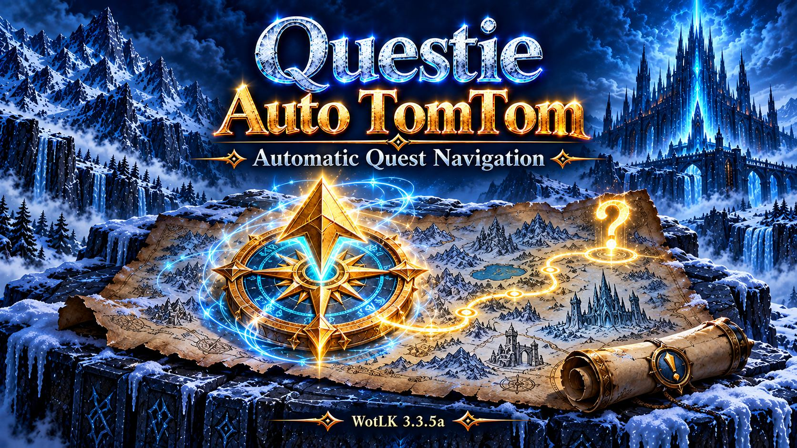

# Questie Auto TomTom

Automatic Questie objective and turn-in waypoints for **World of Warcraft: Wrath of the Lich King 3.3.5a (12340)**.

**Eliminates the need to constantly right-click quests in Questie to send them to TomTom.** Accept a quest and follow the arrow—the helper automatically updates objective waypoints and switches to the turn-in location when the quest is ready.

## Features

- Adds a waypoint for each unfinished objective in your tracked Questie quests.
- Removes completed objective waypoints and adds the turn-in NPC or object when the quest is ready.
- Removes waypoints when quests are abandoned or untracked.
- Uses actual quest completion rather than arrival at a location.
- Displays the objective or NPC name without internal identifiers in the arrow text.
- Uses quest events and Questie tracker updates, with no periodic location scans or movement searches.
- Uses Questie's existing location data; no separate quest database or route planner.

## Requirements

- WoW **3.3.5a**.
- [Questie for 3.3.5](https://github.com/widxwer/Questie), using its `335` branch, or a compatible fork such as [divial28/Questie-335](https://github.com/divial28/Questie-335).
- [TomTom for WotLK 3.3.5a](https://warperia.com/addon-wotlk/tomtom/). Tested with TomTom `v40000-1.0.0`.

The helper has been tested in game by its author. Other Questie/TomTom forks may differ.

## Installation

1. Download [QuestieAutoTomTom.zip](https://github.com/SuttonX/QuestieAutoTomTom/releases/latest/download/QuestieAutoTomTom.zip).
2. Extract the `QuestieAutoTomTom` folder into `World of Warcraft/Interface/AddOns/`.
3. Enable it alongside Questie and TomTom, then restart the client if this is a new addon installation.
4. Keep Questie's tracker enabled. Enable **Auto Track Quests** in Questie if newly accepted quests should be included automatically.
5. In **TomTom → Quest Objectives**, disable **Enable automatic quest objective waypoints** so TomTom's Blizzard-tracker integration does not compete with the helper.

When updating an existing installation, replace the addon folder and reload the UI.

## Commands

| Command | Action |
| --- | --- |
| `/qat` | Show status and commands |
| `/qat off` | Pause and remove the helper's waypoints |
| `/qat on` | Resume automatic waypoints |
| `/qat refresh` | Recreate the helper's waypoints |

The enabled setting is saved account-wide. Waypoints are temporary and removed on logout or when the helper is paused.

## Destination selection

The helper chooses one known location per unfinished objective when quest data or your zone changes, then asks TomTom to select the closest waypoint. Legacy TomTom searches the current zone. If no waypoint is available there, the helper falls back to Questie's nearest destination from that refresh.

The helper does not calculate travel routes between zones, continually select different mob spawns as you move, or optimize a questing route. Objectives without Questie location data cannot receive a waypoint. Quest locations on another continent or instance are excluded.

TomTom's closest-waypoint selection may include your manual waypoints. Use `/qat off` when following a manual waypoint without automatic selection. Helper waypoints stay until quest progress changes; merely arriving does not complete or discard an objective. Updates pause while the world map is open.

## Other addons by SuttonX

- [SetupSwap](https://github.com/SuttonX/SetupSwap) — switch addon sets and UI layouts.
- [FormFreedom](https://github.com/SuttonX/FormFreedom) — automatic form cancellation and dismount handling for supported actions.
- [ConsolePortLK-Enhanced](https://github.com/SuttonX/ConsolePortLK-Enhanced) — controller interface improvements for WotLK.
- [Classfix](https://github.com/SuttonX/Classfix) — alternative class colors across compatible addon frames.
